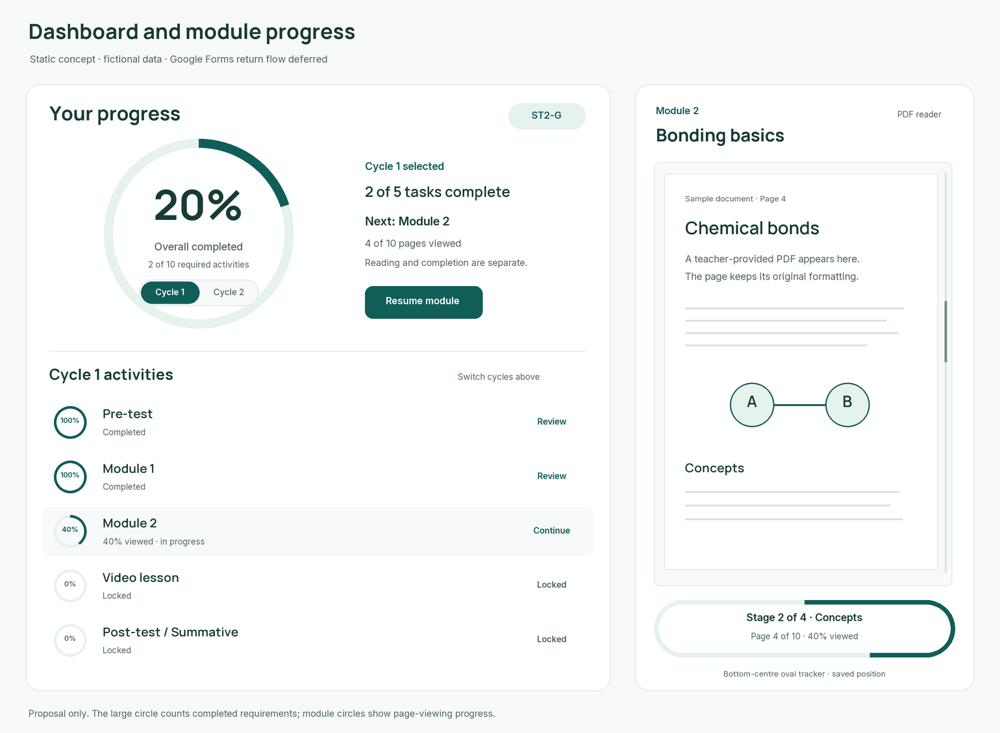

# Dashboard circles and module reader progress

**30 October implementation status:** coded invitation registration, cycle-filtered progress rings, private PDF/native reading observations, oval tracker, landing page and code-based completion reports are now implemented locally. Google Forms authorized response verification and real materials remain pending. See [current evidence](../development/site-update-evidence.md). Earlier proposal/mockup wording below records its original design stage and does not override this status.

29 October 2026 (Asia/Manila). Feature/design proposal, not applied to the app. Google Forms-to-ChemTrack transition planning is explicitly deferred at the user's request.

**Latest scope correction:** there is one module. The preview below predates that clarification: its separate Module 1/Module 2 rows and fixture counts are historical illustrations, not the current content structure. Keep its one-overall-ring/cycle-switch/task-ring/oval layout, and revise its labels/counts in the next visual pass once the single module's stage/cycle map is known.

The original assessment direction is checkpoints inside the module, with format/count/locations still undecided. Required assessment submission gates movement to the next part; no pass score or grading wait is specified. The oval can describe a current section or checkpoint, while viewing coverage and confirmed submitted checkpoints remain distinct.

## Confirmed layout choices

30 October responsive correction: size the overall circle's contents from the available summary-panel width, rather than fixed typography. At panel widths up to 220px, use the short “Overall” label and show the completed-task count below the circle; retain the percentage and cycle switch inside with 44px link targets. Larger panels retain the full label/count. Live browser screenshots and geometry checks at ten widths from 320–1440px passed; no record/calculation changes. The original browser size and cycle selection were restored after checking.

The user clarified that there is **one large circle for overall progress across both cycles**, with a **Cycle 1 / Cycle 2 switch**, and a **small progress circle for every listed task**. Do not replace this with two large cycle circles. Switching cycles changes the visible task list, not the overall-progress denominator.

The user also requests a **fixed bottom-centre oval progress indicator** in the module reader, with the current stage inside. This refines the earlier generic bottom-centre scroll tracker: the perimeter is an oval/pill progress outline rather than a circular donut or a plain horizontal bar.

This is a static concept rendered with the previously proposed Manrope/Inter fonts and teal palette. All data is fictional. The sample has two of ten requirements complete (20% overall), two of five Cycle 1 tasks complete, and four of ten Module 2 pages viewed (40% viewing progress). It is not a screenshot of implemented features or an approved final layout.

## Dashboard behaviour proposal

- Large ring: overall completion percentage, a completed/required count and the cycle switch within its central area. Accessibility text explicitly identifies this as overall completion.
- Cycle switch: shows the selected cycle's task list and counts. It must be usable by touch/keyboard and must not make the overall percentage jump between cycle totals.
- Each row: task title, small progress ring, explicit status and an appropriate action such as Continue or Review. Locked tasks explain the prerequisite.
- Module rows: partial viewing percentage with a label such as “40% viewed · in progress”. Keep completion status separate when required checkpoints remain.
- External pre-/post-test rows: a ring/status placeholder for actual verified completion; do not invent a percentage of Google Form questions answered. Return flow and detailed external states are deferred.
- Video rows: no invented watch percentage for a plain external link. Use the agreed completion state until a measurable player contract is selected.
- Overall percentage proposal: **completed required activities / all assigned required activities across both cycles × 100**. Do not average cycle percentages when their task counts differ, or average assessment scores into completion. A partially viewed module does not silently become a completed requirement.

Proposed activity progress can show partial page coverage while the big circle measures completed requirements. Label those measures visibly so different percentages are understandable. Optional activities should not change the required-completion denominator; optional/required policy is still part of the study setup discussion.

## Three ways to present module documents

| Approach | Result | Tradeoff / status |
| --- | --- | --- |
| Native ChemTrack lesson | Module text and illustrations adopt the full site's fonts/layout and adapt naturally to phones | Best for newly authored or teacher-reviewed converted content; existing lesson support is basic |
| Branded PDF reader | Original PDF pages inside ChemTrack's toolbar/frame, with zoom, continuous scrolling, page indicators and custom progress tracking | Recommended first document capability; PDF page typography stays as supplied; no OCR needed merely to display scanned pages |
| Import text / OCR then review | Extract text from a text PDF, or recognize printed text from scanned images, then format a draft as a native lesson | Possible future content workflow, not a perfect one-click conversion. Equations, tables, diagrams and reading order require teacher review before publication |

Mozilla PDF.js documents loading a PDF and rendering individual pages in a web page. The proposed reader would add ChemTrack's own page containers and tracking around that rendering. Ordinary browser PDF embeds should not be assumed to expose internal page/scroll state reliably to the app. No PDF.js dependency or upload pipeline is installed by this planning task.

“Scan documents” may mean uploading existing scans or capturing paper with a camera. Upload/display of a scanned PDF is covered by the recommended reader; camera capture and OCR conversion are separate optional features, not silently added requirements. No cloud OCR service or paid processing is selected. Teacher content has not arrived yet, so use synthetic documents for preparation.

## PDF viewing progress proposal

Track **unique pages meaningfully displayed**, not the highest page number reached. For example, jumping from page 1 to page 10 of a ten-page module must not imply all ten pages were viewed. Save:

- Current page and normalized within-page position for resume.
- The distinct viewed-page set, bound to student, assigned module and published document version.
- Current teacher-defined stage/section and last server-confirmed save time.

Proposed percentage: **distinct viewed pages / total document pages × 100**. This is a page-viewing estimate, not proof of reading every line or comprehension. A page is not viewed merely because it downloaded or rendered off-screen.

Suggested starting visibility rule, explicitly a developer proposal: the PDF page must be rendered and visible in the active reader/tab; its visible vertical extent is at least half of the smaller of the page height and reader viewport height. This works for a page taller than a phone screen as well as a short page. Determine the current page from the strongest visible page intersection. Review the rule on real materials/devices before treating it as a research observation; no minimum reading time or mastery guarantee is invented.

When revisiting earlier pages, current page/stage can move backward while the distinct viewed-page coverage remains. Zoom, resizing and late rendering recalculate visibility without clearing confirmed coverage. Teacher replacement of a published PDF requires an explicit version policy; do not apply old page coverage to unrelated replacement pages. Resuming must use saved page/offset rather than an absolute document pixel value that breaks at another zoom level.

The server validates ownership, enrollment, eligibility, document version and page bounds. It merges viewed-page sets idempotently and derives percentages; it does not trust an arbitrary client-submitted completion percentage. Save after meaningful changes with debouncing and visible Saving/Saved/Retry states. Only confirmed state is promised after reload; complete offline document sync is not added. Retain minimal useful progress, not a replay of every mouse movement or pixel scroll.

Required assessment submission now explicitly gates advancement. A draft save or 100% viewing is not a submitted assessment. Under the original embedded-checkpoint direction, the reader shows the current permitted part and a checkpoint; only a server-confirmed submission unlocks the next required part. Question format/count and any final module-finish action remain pending. No passing-score or teacher-grading prerequisite is invented.

If stage-level content gating is required for a PDF, hiding later pages in the browser is insufficient. The implementation must authorize stage content on the server and avoid delivering the full locked PDF upfront, for example by publishing authorized section files or native sections. A continuous viewer may show unlocked content and locked-stage placeholders. Exact document partitioning depends on the eventual teacher material and assessment placement; it is not solved by a progress percentage.

## Bottom-centre oval tracker

Use an oval/pill outline whose perimeter fills with the viewing percentage. Keep readable text in the centre, for example:

**Stage 2 of 4 · Concepts**  
Page 4 of 10 · 40% viewed

These four stages are illustrative; real stage labels/counts come from the teacher's module outline or mapped PDF page ranges, not arbitrary equal quarters. Current stage describes location; completion coverage can remain higher when the student returns to an earlier stage. Support an unsectioned PDF with a clear page indicator rather than fabricated stage titles.

The control stays at the bottom centre of the reader viewport with safe-area spacing and reserved document padding so it does not obscure the PDF, quiz controls or finish button. Support wheel, touch and keyboard scrolling; provide zoom/page controls and accessible text independently of the animated outline. Use restrained updates and reduced-motion support. Failure to save must be visible, without replacing the current stage with an unexplained spinner.

## Implementation stages and checks

1. Agree the visual proposal and the distinction between viewed pages and completed requirements; confirm document strategy when teacher material format is known.
2. Implement the overall ring/cycle switch/task rings against real server progress, including empty/locked/error states and unequal cycle task counts.
3. Add an authorized PDF upload/reader with file validation/limits, on-demand rendering, text/accessibility support where the document permits, continuous scrolling and saved versioned coverage.
4. Add stage mapping and the fixed oval indicator, then connect module observations to dashboard rows under the agreed rule.
5. Verify synthetic multi-page/text/scanned PDFs, skipped pages, tall/short pages, resize/zoom, backtracking, off-screen rendering, failed saves/reload, foreign access and duplicate/out-of-order save requests. Check real devices and large-document performance before claiming readiness.

Keep existing attempts, timestamps, programme content locks, coded-identity requirements and separate completion/scoring semantics. OCR/import is a later optional content pipeline; it must not block this reader/dashboard proposal. External Forms submission/return transitions remain outside this turn's scope.

## Evidence and status

Official references checked: [PDF.js browser rendering examples](https://mozilla.github.io/pdf.js/examples/), [PDF.js page/text APIs](https://mozilla.github.io/pdf.js/api/draft/module-pdfjsLib-PDFPageProxy.html), [Tesseract printed-text recognition](https://tesseract-ocr.github.io/tessdoc/).

Created and visually reviewed the static concept with consistent fixture arithmetic. No reader, circles, cycle switch, document import or activity tracking code is implemented. Browser viewing remains disabled; no live interaction or PDF rendering test is claimed.
