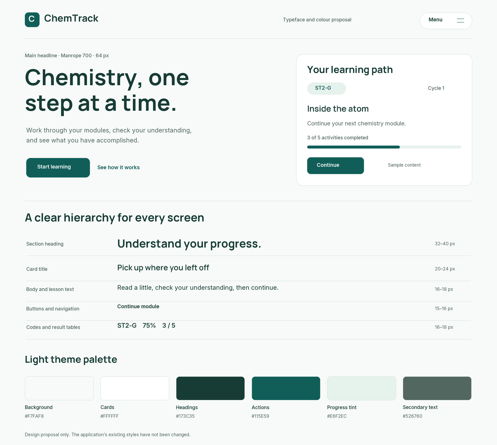

# Typography and theme proposal

Updated 30 October 2026 (Asia/Manila). Manrope headings, Inter reading text/controls and the teal/off-white direction are now applied to the landing and student workspace through self-hosted WOFF2 assets. Filament retains its own administration styling. New screens await visual/real-device review; see [implementation evidence](../development/site-update-evidence.md). The board below is the earlier static proposal, not a screenshot of the app.

## Direction

Use **Manrope for headings** and **Inter for reading text, navigation and controls**. The heading family provides a friendly geometric identity; the body family keeps longer lessons, labels and tables clear. Build on ChemTrack's teal direction with an off-white/mint surface system and deeper green text. Pantas is a motion reference, not a requirement to copy its full visual identity.

The image is an original static typography/colour board with fictional UI content. It uses the actual downloaded font files, not substitutes. It does not demonstrate browser rendering, interaction, final layout or mobile behaviour. The main headline and supporting text are proposed copy, not approved content or a promise of study results.

## Type hierarchy

| Role | Family / weight | Desktop size | Phone size | Treatment |
| --- | --- | --- | --- | --- |
| Landing main headline | Manrope 700 | 64 px | 40 px, fluid wrapping | Line height 1.08; slightly tight spacing; one clear message |
| Landing section heading | Manrope 700 | 32–40 px | 28 px | Line height 1.15; descriptive sentence case |
| App page title | Manrope 700 | 32 px | 28 px | Line height 1.2; one H1 per page |
| Activity/card title | Manrope 600 | 22–24 px | 20 px | Line height 1.3; short and scannable |
| General body text | Inter 400 | 16–18 px | 16 px | Line height 1.6; strong contrast |
| Module reading text | Inter 400 | 18 px | 17–18 px | Line height 1.65–1.75; around 60–70 characters per line |
| Buttons and navigation | Inter 600 | 15–16 px | 15–16 px | Sentence case; stable labels |
| Student codes, scores, table values | Inter 500–600 | 16 px | 16 px | Tabular numerals for aligned data; preserve exact code characters |
| Supporting labels/save status | Inter 400–500 | 14 px | 14 px | Supporting information only; visible state text |

Sizes are starting tokens, not fixed widths. Use fluid interpolation and natural line wrapping rather than shrinking text to force a heading onto one line. Respect browser text scaling and zoom. Keep semantic H1/H2/H3 order independent of visual size. Use real subscript/superscript markup for chemistry notation; do not flatten formula meaning into decorative lettering.

Proposed headline: **Chemistry, one step at a time.**

Possible descriptive headings: **How ChemTrack works**, **Pick up where you left off**, **See what you have accomplished**, **Your learning path**. Refer to code-based accounts in app copy; do not reintroduce student names into personalized greetings.

## Core light palette

| Token | Colour | Use |
| --- | --- | --- |
| Page | `#F7FAF8` | Main canvas |
| Surface | `#FFFFFF` | Reading/assessment panels and cards |
| Ink | `#173C35` | Main headings and primary text |
| Primary | `#115E59` | Main buttons, active navigation, progress fill |
| Mint | `#E6F2EC` | Selected surface and progress track |
| Muted text | `#526760` | Secondary text and supporting labels |

Supporting tokens: decorative divider `#D7E4DD`; control boundary `#7A9087`; pending text `#8A5A16` on `#FFF2D4`; error text `#B42318` on `#FFF0EE`. Status text/icons accompany colour. Completion, reading and assessment scores retain separate meanings; a decorative green state cannot substitute for a verified result. Codes with G/B suffixes share the same neutral styling; no separate category colour scheme is needed.

## Component and motion application

Use generous reading space and clear section hierarchy. White surfaces group actual tasks; reserve stronger teal for the main action on a screen. The normal landing header and the independent fixed top-right menu remain as requested. The bottom-centre reading tracker uses Inter for a compact percentage/status label; its progress is based on saved reader state when implemented.

Let the landing page's feature demonstrations carry most motion. Headline copy should be readable without waiting through character-by-character reveals. Keep body text stable while reading; offer reduced-motion alternatives. Dark mode is not added to this proposal without a separate need and review.

## Fonts and performance

The source variable TrueType files and SIL Open Font licenses are in `assets/design/fonts/`, retrieved from the Google Fonts repository. The original TTFs remain source assets; optimized WOFF2 derivatives in `resources/fonts/` now serve the app. No system fonts were installed. See [font sources](../../assets/design/fonts/README.md). The current implementation preserves licenses and uses `font-display: swap` and a suitable system fallback. Limit loaded families/styles to those actually used; verify font swaps do not disturb the reader or tracker.

Sources: [Manrope](https://fonts.google.com/specimen/Manrope), [Inter official site](https://rsms.me/inter/).

## Verification and status

Rendered the board using the actual Manrope/Inter fonts and visually inspected it for text fit and spacing. Nine calculated foreground/background pairs passed their proposed thresholds: text pairs at least 4.5:1 and the control-boundary pair at least 3:1. Recorded ratios are in `assets/design/typography-theme-contrast.json`. These numeric checks cover the proposed tokens only; they are not a complete accessibility audit or a browser test.

Pending: user reaction to the pairing/palette, full page composition, responsive browser review, webfont loading and application integration. No app code or real student data changed. This continues one ChemTrack visual direction rather than introducing another competing design manual.
