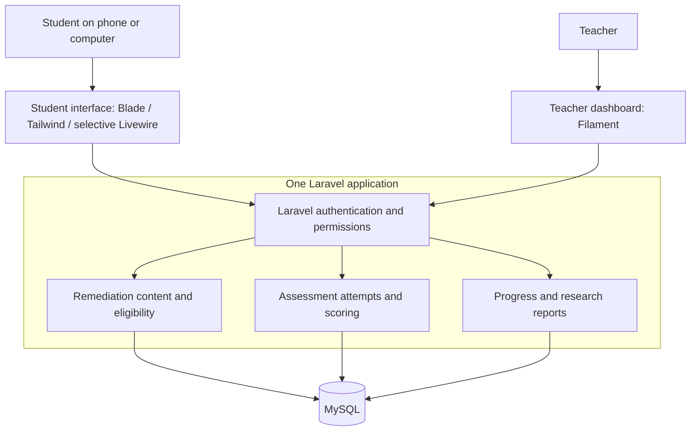
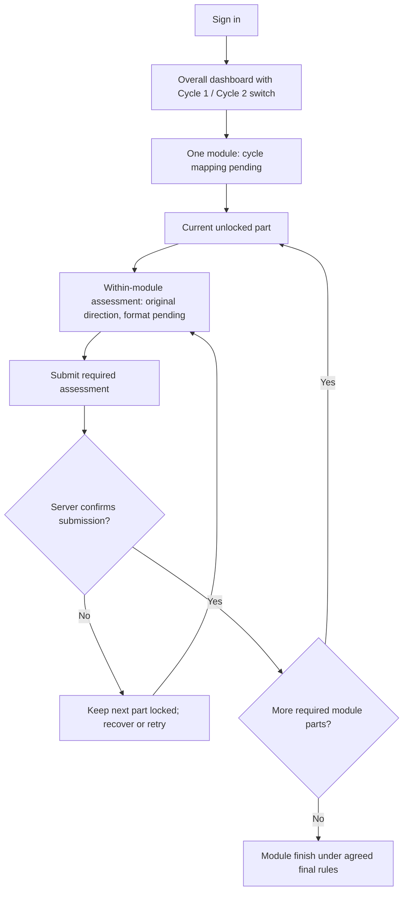
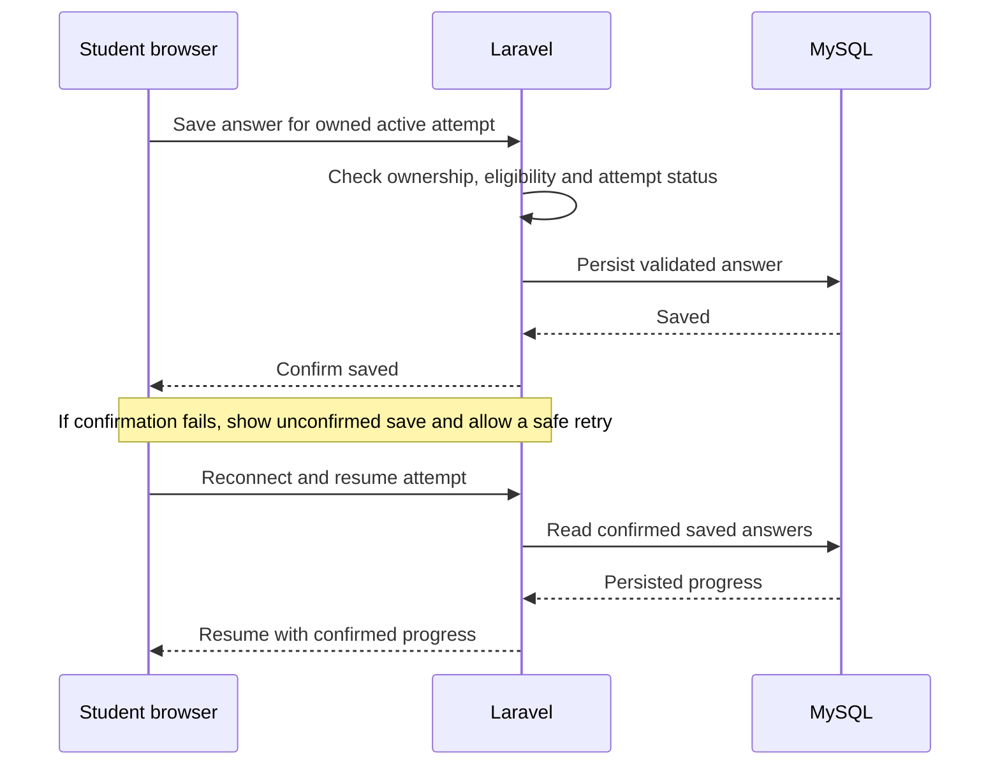
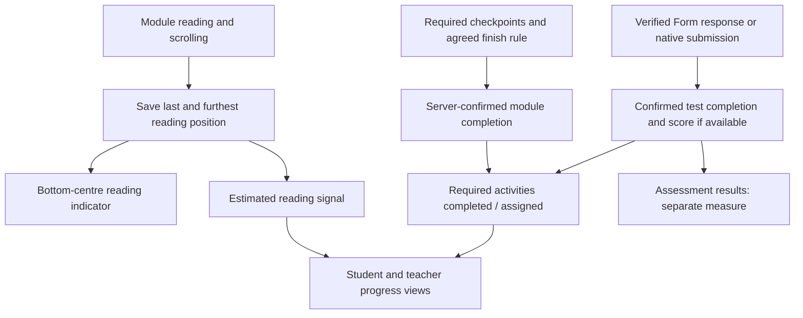

# System planning figures

Status: discussion draft, updated 29 October 2026 (Asia/Manila). Teacher screenshots now confirm two cycles; the precise instrument arrangement remains open. A first local application implements the shared architecture and a configurable demonstration sequence. The new cycle/Form/scroll features below are planned, not implemented. See the [feature proposal](../project/teacher-requirements-feature-plan.md) and [existing build evidence](../development/first-build-evidence.md).

## Figure 1 — Application architecture

Both interfaces use the same application and database. Server rules control access; students cannot bypass eligibility or view other students' records by changing URLs. Proposed service responsibilities do not imply separate servers or microservices.

## Figure 2 — Single-module assessment gate: placement/format pending

One module and two cycles are confirmed; how the single module is divided or used across the cycles remains open. This diagram shows the original within-module assessment direction, with exact formats/counts/locations undecided. Submission-gated advancement is confirmed; a pass score or teacher-grading prerequisite is not. Pre-/post-test, video and survey placement are separate unresolved details; external Forms return-flow planning remains deferred. A draft save or scroll percentage cannot satisfy a submission gate.

## Figure 3 — Saved answers and connection recovery

The existing native demonstration implements confirmed saves, retries and final server scoring; no full offline mode is promised. Proposed external Forms submissions need their own verification contract. Timers, retakes, feedback release and local drafts remain design questions.

## Figure 4 — Separate reading, completion and performance

Reading signals remain separate from compliance and scores. Reaching the bottom cannot submit an assessment, invent an external result or independently unlock the next cycle. The exact module finish rule is a proposal awaiting confirmation.

## Planning agenda

| Topic | Baseline / discussion needed |
| --- | --- |
| Study and learning flow | Two cycles of chemistry remediation at home; confirm test placement, content counts and completion rules |
| Accounts and access | Student and teacher; confirm enrollment, class scope and administrator needs |
| Content | Modules, videos, short assessments; confirm formats and teacher publishing workflow |
| Assessment rules | Confirm item types, scoring, attempts, timers, feedback, eligibility and overrides |
| Student screens | Proposed activity dashboard, cycle view, module reader with bottom-centre scroll progress, video, test/Form return, survey and results/progress |
| Teacher screens | Proposed students/classes, content, assessments, monitoring, research reports |
| Data model | Preserve versioned assessments, attempts, answers, progress and timestamps |
| Research reports | Confirm which attempts count, cohort comparisons, missing-data handling and exports |
| Reliability | Confirmed saves, resume, safe retries and duplicate-submission prevention |
| Hosting and maintenance | Compatible PHP hosting; optional Cloudflare layer; current compatibility/cost checks later |
| Implementation | Agree on rules and design, then plan complete usable build stages with acceptance tests |

Current decisions: confirm instrument placement in the two cycles, external Form verification and module/video completion rules. Dashboard and visual design follow the feature-plan discussion.
