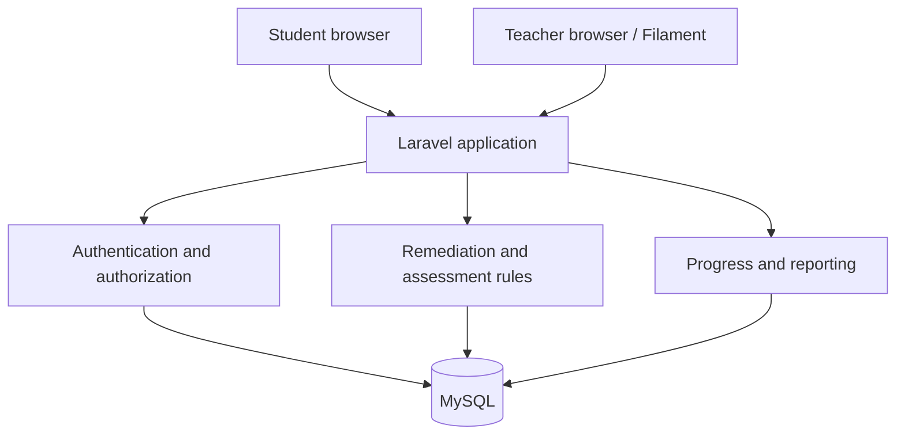

# Architecture plan

## Implemented revision — 4 November

The [cycle/account/settings build](../development/cycle-accounts-settings-evidence.md) adds programme cycle-workflow metadata and auditable release records, independent four-stage summaries, video activity support, private identity/email challenge/account-completion fields and user preferences/pending-email/avatar/native MFA/audit metadata. Preserve earlier attempts/reading/completions and old-map ordering, but calculate new per-cycle totals honestly. Email verification and teacher Forms result verification are separate. Existing monolith/dependencies retained; private identities encrypted and ordinary learning/research views remain coded.

## Application

The first local build uses Laravel 13.39.0, Blade/Tailwind 4.3.3 student screens and Filament 5.11.0 / Livewire 4.4.8 teachers. Student answer-saving uses small browser requests rather than reactive server requests on every interaction. The MySQL driver connects to MariaDB 10.11.16 locally. Composer and pnpm lockfiles record package resolution. Compatibility was resolved normally with installed PHP 8.3.36; no platform requirements bypassed.

## Data model direction

One database can contain all entities: users/roles, classes/enrollments, cycles, modules, assessments, questions, attempts, answers, and progress. Names are provisional until migrations are designed.

Keep `student_id`, `assessment_id`, attempt number, status, start/submission times, and score for each attempt. Keep individual answers linked to attempts and question/assessment versions. Use transactions and uniqueness rules for submission and retry handling. Define how corrections/regrades are recorded rather than silently rewriting research records.

First-build mapping: teacher-owned `programmes` contain ordered `activities` (lesson/pre_test/checkpoint/post_test). `programme_user` records enrollment; `attempts` store answer arrays and start/save/submission timestamps with one attempt per student/activity; `completions` record lesson completion. Questions/options/answer keys are authored as JSON on an activity. Content freezes on the first learner activity, preserving this version without a separate version-history UI. Submitted scores/answers cannot be edited through the application. Retakes and correction/regrade workflows are pending.

Learning writes lock the parent programme and refresh the activity before evaluating its rules. Content-edit guards use current locking reads to avoid a stale MariaDB REPEATABLE READ snapshot. Teacher resources/policies and reports scope all records to the current teacher. CSV uses pseudonymous student references and escapes formula-like titles.

## Connectivity

Teacher interface: a separate compiled Filament theme (`resources/css/filament/admin/theme.css`) shares fonts/palette/logo with student screens while preserving the native management shell. TeacherDashboard supplies owned programme/student shortcuts. ViewUser exposes code-based individual progress without account identity form state; ViewProgramme permits read-only access after content freezes. ProgressReport supplies both the programme matrix/export and individual overview, with teacher/student ownership filters. EnrollStudents is the shared validated action for programme list/view; existing policies still deny edits after learning begins. Teacher form relationship records explicitly make saved questions visible, while Activity's default hidden questions remain unchanged for student-facing serialization. No schema changes accompany these pages.

The [site update](../development/site-update-evidence.md) implements nullable activity cycle labels, private document paths, native/Google Forms source settings and versioned `reading_progress` rows. Reading stores current/furthest position, current/page count and distinct viewed pages per student/activity. A unique pair and programme locks serialize writes; content fingerprints include PDF bytes. Reading starts the content freeze but cannot directly unlock prerequisites. Overall completion includes all activities before cycle filtering. External-source tests cannot enter native scoring/completion endpoints. Original Google Form responder screens with authorized read-back remain selected; no live response integration exists.

Implemented accounts: unique nullable student codes, G/B category and nullable email; preseeded `student_code_counters` with separately locked installation-wide sequences; hashed single-use seven-day `student_invitations`. Registration allocates the code, consumes the invite and enrolls in one transaction, accepting no client role/teacher/code. New student display names contain their code and email is null. Teacher email login and legacy fictional credentials/history remain. Student/roster/report displays use codes or neutral references. See [account contracts](student-codes-and-form-verification.md).

Implemented reader foundation: private teacher-scoped PDF uploads with metadata/save path-tampering protection, eligibility-checked inline delivery, dynamically imported PDF.js 6.4.299 and bundled worker. Native/PDF observations save bounded positions/page sets with version guards and explicit retry. Reports separate reading estimates, completion and native scores for all assigned students. OCR/import is not installed. Actual PDF rendering/zoom and real-device appearance await browser access; see [reader design](../design/dashboard-and-reader-progress.md).

Latest module contract: one module, with its relationship to the two cycles still to be mapped. The original direction embeds assessment checkpoints; format/count/placement remain pending. Required submission must be confirmed by the server before advancing to the next gated part. Do not substitute draft saves, viewing percentage, a hidden button or an invented passing-score/teacher-grading gate. For strict PDF stage gating, authorize section content before delivery; do not serve a complete locked document and rely on hiding later pages. No such intra-module contract is implemented by the existing flat lesson/assessment demo.

Save confirmed answers server-side at meaningful interaction points. Show saving and failure states; retry safely and resume incomplete attempts. Avoid requests for every keystroke and unnecessary polling. Version 1 needs internet and does not promise that unsaved answers survive disconnects or a browser crash. Local drafts would be a separate design decision requiring shared-device privacy consideration.

## Deployment direction

Use PHP hosting with MySQL, compatible PHP/extensions, Composer or a supported build/upload workflow, secure environment configuration, writable storage/cache directories, HTTPS, and document root pointing to Laravel's `public/`. Verify SSH, cron, backup restore, resource limits and supported package versions before purchase.

Cloudflare may sit in front of the host for DNS/security/CDN. Do not cache private student pages or authenticated responses publicly. Keep application secrets and research data outside public files. Avoid storing large videos on small hosting plans.

Temporary development access now uses an explicitly requested shared-password Caddy gate on loopback 8001 before Cloudflare Quick Tunnel transport. Laravel accepts only the forwarded protocol header from loopback proxies, with regression coverage for trusted/untrusted sources. The preview process alone disables debug output and sets secure session cookies; no production host is configured. Any future non-loopback production proxy needs its own reviewed trusted-proxy configuration. See [remote preview](../development/remote-preview.md).

The prior chat preferred Z.com Starter; all plan prices/features from that discussion remain historical estimates requiring a fresh check. No host or domain has been provisioned. Persistent workers and a serverless rewrite are outside initial scope.
