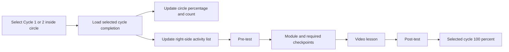
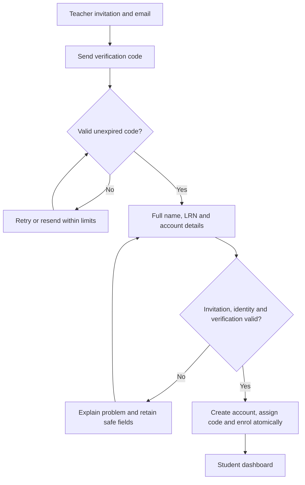

# Separate cycle progress, verified registration and account settings

Approved plan — 4 November 2026 (Asia/Manila). User authorized execution; implemented locally with evidence and external-input limits in [build evidence](../development/cycle-accounts-settings-evidence.md). The original planning text below is retained as the design rationale. This document separates the user's new requirements from proposed defaults and unresolved decisions.

## Confirmed direction from this request

- Replace the combined progress total with independent Cycle 1 and Cycle 2 totals.
- Retain one large circle with clickable Cycle 1/2 controls inside it. Selecting a cycle changes the circle percentage, completion count and right-side activity list together. Apply this to student dashboards and teacher student profiles, with separate cycle totals in reports.
- Each cycle has this order: pre-test → module → video lesson → post-test. Pre-/post-tests retain the selected original Google Forms responder approach, with actual response verification required for recorded completion.
- Plan a fuller signup with email, full name, password/confirmation, LRN and appropriate additional information, with email verified before continuing registration.
- Add teacher profile customization, appearance/themes and normal account/settings controls. Propose corresponding student self-service settings.
- Plan together first; do not change application code, database records, accounts, credentials, materials, mail delivery or deployed behavior in this turn.

The new per-cycle calculation supersedes the combined-circle requirement as the planned target. Existing combined behavior remains implemented until the later build. The user clarified that signup collects real information, held in private account details, while learning dashboards, teacher progress views, research reports and exports use codes/anonymity. This supersedes code-only collection as the planned signup target; existing code-only registration remains implemented until built. No real identity data has been collected by this planning turn.

## 1. Cycle learning and completion contract

One selected cycle drives all three pieces of UI: percentage/count in the circle, selected control, and activity list. Suggested label: “Cycle 1 completion” / “Cycle 2 completion”. Do not continue labelling a selected-cycle percentage as completion across both cycles. Remember the selected cycle without modifying learning history.

Recommended initial formula: completed required stages in the selected cycle ÷ 4 × 100. Each of the four required stages contributes 25%; no unapproved score threshold. Example: pre-test/module completed in Cycle 1 = 50%, while locked Cycle 2 stays 0%. After Cycle 1 reaches 100% and the teacher opens Cycle 2, completing only its pre-test gives Cycle 2 25%; Cycle 1 stays 100%. Switching restores the selected cycle’s own saved progress.

| Required stage | Small activity ring / evidence | What completes the stage |
| --- | --- | --- |
| Pre-test | Pending, verified submitted, and score when available | Matched actual submission to the assigned Google Form/test; merely opening the Form does not complete it |
| Module | Saved reading position/coverage plus embedded assessment status | All configured required module parts and embedded assessment submissions confirmed; viewing 100% alone does not complete the module |
| Video lesson | Playback position/observations where supported | Proposal: explicit “Finish video lesson” acknowledgement for the first build; accurate automatic watch-based gating requires the actual video source/player and an agreed rule |
| Post-test | Pending, verified submitted, and score when available | Matched actual submission to this cycle's assigned post-test Form |

Do not count embedded checkpoints as extra outer stages unless the user changes the four-stage weighting. They are module completion requirements; their own progress remains visible inside the module. Missing/unconfigured stages must show “Not available yet” and must not be silently dropped to inflate the percentage. A newly configured cycle with no completed stages is 0%, even when no materials have been supplied.

Keep small rings, reading estimates, draft answers, confirmed stage completion and test scores distinct. Preserve attempt/answer/timestamp history and duplicate-safe submissions. The server enforces eligibility; a tab switch never unlocks an activity. Students may inspect a locked cycle's list.

Confirmed follow-up: Cycle 2 requires BOTH that individual student's Cycle 1 completion and teacher release of Cycle 2. Selecting the cycle is always allowed to preview the locked list; it cannot bypass either server gate. Show “Finish Cycle 1” and/or “Waiting for your teacher to open Cycle 2” as applicable. Video acknowledgement is completion evidence, not proof of watch duration or attention.

Proposed release scope: a teacher-owned programme/group release, not a student self-service or individual bypass. Teacher dashboard shows stage readiness and eligible/waiting counts, with an “Open Cycle 2” action. Server checks ownership and required Cycle 2 setup, records the releasing teacher/time and handles repeated clicks safely. Releasing does not complete Cycle 1 for anybody: only students who completed it can enter. Do not add silent relocking that disrupts already-started attempts; pausing/reopening after launch is a separate policy if later requested. Exact programme/group release granularity remains a proposed implementation detail, since this application currently has programmes rather than class groups.

The existing “one module” decision still stands. Model cycle-specific assigned portions of that module or shared material with separate cycle participation/completion records; do not silently duplicate content or count a prior-cycle completion toward the other cycle. Teacher must clarify whether both cycles reuse the same material or use different parts of the single module. Real material placement and embedded assessment details remain pending.

## 2. Student signup: verify email before profile completion

Proposed first page: teacher invitation/class access token plus email. Class/student ownership must come from the invitation on the server, never a user-selected teacher or role. Retain controlled enrolment rather than making all verified internet users students in the study.

Proposed sequence:

1. Enter invitation and email; request a verification code.
2. Enter the emailed code on the verification page. Show masked destination, expiry, resend countdown and a change-email path.
3. After verification, enter full name, LRN, password/confirmation and agreed additional fields. Email is already verified; editing it requires another verification.
4. Review details and the study/account notice supplied by the teacher. Do not invent research consent wording or make a checkbox stand in for a required guardian/school process.
5. Revalidate the invitation, email verification and duplicate identity rules; atomically create the account, permanently assign its student code and enrol it. Consume the invitation only at successful final creation.
6. Show the assigned student code and enter the authorized dashboard.

Proposal: six-digit codes, ten-minute expiry, single use, five failed attempts per challenge and at least a sixty-second resend interval. Store a protected verifier and server-bound challenge, apply request/attempt limits per challenge/email/IP, invalidate old codes on resend, and expire unfinished sessions. Exact limits are implementation defaults for review. Do not allocate codes or consume invitations merely for requesting an email. An email verified in one abandoned or foreign session must not authorize another registration.

Email verification establishes mailbox control; it does not validate an LRN, school affiliation or ownership of a claimed real name. Use teacher roster matching or teacher confirmation if eligibility depends on those claims. Do not offer a public LRN lookup or reveal existing-account details.

| Field | Proposed requirement / treatment |
| --- | --- |
| Email | Required and verified before profile stage; usable for login/recovery |
| Full name | Required in planned signup, retained in private account details; codes in learning/research views |
| LRN | Requested by user; confirm institutional format and eligibility/duplicate rules, protect value and restrict access/corrections |
| Password + confirmation | Required; retain at least 12 characters, allow long passphrases, paste/autofill/password managers and show/hide controls |
| Grade/year and section | Suggested school context if needed for the study/roster; allowed values set by teacher |
| Mobile number | Suggested optional contact field unless teacher identifies a necessary use; no SMS verification in initial scope |
| G/B category | Retain separate ST1-G / ST1-B issuance if still approved; do not infer category from name/email |
| Student code | Assigned by server at final signup; immutable to profile edits, retained in progress and research exports |
| Study/account notices | Teacher-approved privacy/participation wording and process; unresolved rather than fabricated |

Do not add date of birth, home address, guardian details or identity-document uploads merely because other signup forms have them. An optional profile avatar is not an identity check.

## 3. Sign-in, recovery and security

- Support email or existing student code plus password. Teacher email sign-in remains. Show/hide password, clear accessible validation, password-manager support and usable loading/error states.
- Unfinished registration returns to its permitted verification/profile step. A full learning session requires completed registration and verified email, enforced on server routes.
- Forgot-password flow sends a short-lived single-use reset link with rate limits and a generic response. Reset should revoke other sessions; teacher assistance remains controlled.
- Settings for changing password require current-password confirmation. Changing email requires verification of the new mailbox, notification to the prior address, and atomic promotion only after confirmation.
- Active sessions with last activity and ability to sign out other sessions; avoid presenting precise location inferred from IP as reliable.
- Optional two-factor authentication for teachers, including protected recovery codes and a usable recovery process. Never make SMS recovery an assumed dependency.
- Retain password hashing, CSRF protection, role/ownership checks, safe session handling and throttling. Require HTTPS/correct cookie settings before real external use.
- Private identity data must be omitted from routine learning payloads, progress tables and research CSVs. Protect sensitive fields at rest, restrict authorized account access and record sensitive changes without logging raw LRNs/passwords/verification codes.
- Students cannot self-change role, teacher, enrolment, student code or LRN. Provide a correction request or authorized teacher process; retain a change record.
- Existing coded accounts must retain progress and credentials. Plan a controlled account-completion/email-verification migration rather than deleting accounts or assigning fabricated identities. Public signup cannot claim an existing student code.

## 4. Profile and settings

Entry points: avatar/user menu and a visible Settings item in both teacher/student navigation. Save/cancel, saved confirmation and recoverable errors should behave consistently. Keep normal profile edits separate from programme rules.

| Area | Teacher | Student proposal |
| --- | --- | --- |
| Profile | Name, display name, optional avatar and school/designation, private contact information | Private name/contact details, optional avatar, read-only student code/school assignment; LRN masked/read-only |
| Account and security | Verified email, password, sessions, optional 2FA | Verified email, password, sessions and recovery |
| Appearance | Light / dark / system, standard / larger text, reduced motion | Same preferences |
| Notifications | Security messages mandatory; optional study-approved reminders and progress notifications | Security messages mandatory; optional study-approved learning reminders |
| Learning dashboard | Default cycle and saved sidebar preference; profile/avatar entry point | Remember selected cycle and sidebar preference |
| Privacy and help | Account-data guidance, help/contact, study policy supplied by teacher | Same, plus a private correction/contact path |

Keep the accepted teal/Manrope/Inter identity in all themes. Theme should apply across workspace, profile/settings, reports and learning/assessment pages; public/login pages should follow the chosen device/session appearance consistently. Save account preferences across devices after sign-in, with local fallback for guests and no bright theme flash. Preserve readable contrast, keyboard focus and reduced-motion preference. Scope is three tested themes, not an arbitrary colour/theme builder.

Avatars need type/size validation, image re-encoding and private or controlled delivery. Show initials when absent. Do not accept executable SVG/HTML uploads as profile images. Real student names must not leak through avatar labels, filenames, search results or a teacher's progress/export view when code-based presentation is selected.

No default collection of extra telemetry, marketing email, public student profile, chat, leaderboard or new administrator role. Add reminders only after schedule/purpose are settled; a preferences toggle is not evidence that a reminder service exists.

## 5. Teacher programme management and reporting

Teachers configure the four required stages per cycle, module portions/checkpoints, Form links and video source, and publish only when required setup is complete. Show draft/missing-setup status clearly. Continue viewing frozen content read-only after learning begins; changes require a safe versioned/revised programme rather than rewriting recorded work.

Teacher student profiles mirror the selected cycle's circle/list. Programme reports and CSVs have separate Cycle 1/Cycle 2 completion and stage statuses; pre-/post-test scores stay separate and missing external scores remain missing. Progress/research screens use student codes. A restricted student-account details screen is the proposed place for real name/email/LRN, with explicit role-scoped access; do not expose identity through routine progress screens.

## 6. Technical impact and order

Stay with Laravel/MySQL/Blade/Filament. No application edits or migrations during this discussion. Later implementation will need cycle-stage assignments and participation records, per-cycle completion queries, a standalone video activity, registration challenges/identity fields, verified-account route gates, profile/settings, and mail delivery. Reuse existing authorization, invitation, code allocation, attempts, reading and report services where possible; do not duplicate histories or build a separate frontend.

1. Identity/private-account versus coded-research presentation and two-condition Cycle 2 gating are confirmed. Settle module reuse/parts, video completion rule, additional signup fields, email-verification format and teacher release granularity.
2. Build separate cycle structure/calculation and coherent student/teacher/report UI, preserving all existing work through a controlled mapping.
3. Build staged verified registration, account-completion migration, login/recovery and secure private identity access. Connect a teacher-approved real mail sender; local log/captured email is testing only.
4. Build profile/settings, theme preferences and teacher security controls.
5. Connect real Google Forms results and approved module/video materials; rehearse both cycles end-to-end and then repeat responsive/accessibility/security checks.

Real inbox delivery was not configured or verified in this planning pass; the application has no email-verification flow yet. Config defaults to a log mailer when unspecified; do not claim existing live mail capability. A separate website email verification does not sign the student into Google Forms or grant response-read access.

Acceptance checks for later build: switching cycles changes percentage/list together without changing the other cycle; 2/4 shows 50%; after Cycle 1 completion and teacher release, Cycle 2 at 1/4 shows 25% while Cycle 1 remains 100%; missing configuration never yields 100%; stage locks and BOTH teacher release plus Cycle 1 completion enforced on server; teacher release cannot affect foreign programmes or bypass unfinished Cycle 1; no fake Form completion; module checkpoints/video rule honored; prior histories retained; verification expires/resends/replays/duplicate finalization/foreign sessions handled; identity and teacher boundaries preserved; recovery/session revocation works; themes/focus/readability/save states checked on real screens.

## Confirmed follow-up and remaining decisions

1. Confirmed by follow-up: real identity at signup/private account details, code-based learning/teacher-progress/research presentation.
2. Confirmed by follow-up: finish Cycle 1 AND wait for teacher release to enter Cycle 2; permit a locked-list preview. Programme/group release scope is proposed.
3. Do cycles reuse the same module or use different portions of the one module? Neither completion should be copied automatically to the other cycle.
4. Video completion: explicit acknowledgement initially, or verified player observations under a specified rule once the source is known?
5. Required school/contact fields, approved notices/participation process, and six-digit code versus emailed link for the verify-first step.
