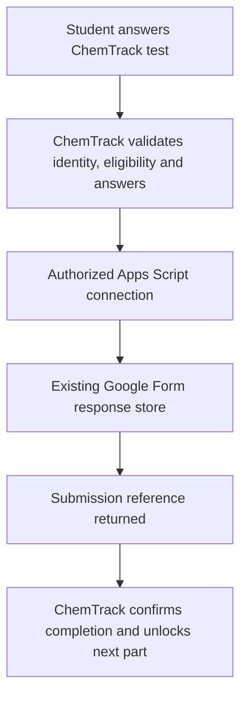

# Custom ChemTrack tests with Google Forms response storage

29 October 2026 (Asia/Manila). Feasibility finding and proposed integration; not implemented or tested with a teacher-owned Form.

**Superseded direction:** the user subsequently selected option 2: students use the original Google Form responder interface; ChemTrack reads actual responses/results to confirm completion. The custom script-write bridge below is historical analysis, not the selected implementation. See [student codes and native Form verification](student-codes-and-form-verification.md). No Google login to ChemTrack is required by that proposal.

## Requested behaviour

Students answer pre-tests and post-tests/summative tests inside ChemTrack's own interface. No Google Forms iframe is used. Submitting should create a response in the teacher's existing Google Form. The user now identifies the post-test as the summative test; exact instruments per cycle still need mapping.

## Supported approach

### Google sign-in is separate from a signed-in Form response

Follow-up checked on 29 October: the user asks whether students can sign in with their own Google account in ChemTrack, see a restyled version of a Google-sign-in-required Form, and submit as that Google respondent with all restrictions intact.

Google sign-in can authenticate a student to ChemTrack. It does not by itself supply an authenticated Google Forms responder submission endpoint or guarantee the Form's verified respondent identity. The Forms REST responses API still has only get/list. Google explicitly disallows Apps Script response submission with the Form's one-response-per-user option enabled, regardless of adding Google sign-in to the app. Therefore do not promise that the complete requested flow preserves arbitrary native Google Forms sign-in, verified-email and attempt restrictions in a custom interface.

For the proposed owner-authorized bridge, the teacher/authorized owner supplies the Google authorization; students may separately use their own allowed Google accounts to sign in to ChemTrack. Apps Script can alternatively execute as the accessing user, but that requires its own authorization/access configuration and does not remove the documented response-limit restriction. Do not assume that executing as a student is a universally supported workaround or that its Form respondent-email field necessarily matches a ChemTrack login.

Two honest alternatives remain: (1) custom tests with Google login, ChemTrack-owned identity/enrollment/attempt enforcement, and compatible script submission using an explicit participant reference/email answer; or (2) the native Google Form responder screen when its native Google-account verification/restrictions must be preserved. A participant-email answer supplied by the application is distinct from Google's native verified respondent-email metadata. Neither alternative is selected by this feasibility question. No Google login/integration is implemented, and materials remain unavailable.

Google Apps Script documents creating a Form response, attaching answers to its question items and submitting it to the Form response store. The standard Google Forms REST responses resource only exposes get/list; it does not offer a response-creation method. Use a teacher-authorized Apps Script bridge rather than assuming REST submission exists or posting to undocumented browser endpoints.

Proposed flow:

Apps Script web apps support HTTP POST handling and configurable execution identity. Deployment/access settings must fit the teacher's Google account and school policy. Keep connection credentials out of student browsers and project documents. No deployment, authorization or external submission has been performed.

## Preparation before materials arrive

The user confirms that teaching materials and actual Forms are not available yet, and wants the system prepared ahead of them. Missing materials do not block preparing the application foundation. Build and demonstrate the custom assessment flow with clearly fictional questions; make content, test assignment and the Google connection configurable rather than hardcoding future teacher material.

Preparatory scope can include the test renderer, question validation, agreed draft/attempt rules, pending/confirmed/failed delivery states, retry/reconciliation handling, teacher configuration and setup instructions. Automated simulated success/failure/duplicate checks can verify the application contract without claiming a live Google integration passed. Keep an unconfigured assessment unavailable to real participants; never show mock delivery as a real Form receipt.

Later, with teacher-authorized access, map actual Form items, verify supported settings, load the approved instruments and run a synthetic end-to-end check against an approved test copy. Only that stage can establish compatibility with the teacher's real Forms. Visual design and implementation of this preparatory scope remain pending; this paragraph records what can be prepared, not completed features.

## Required checks before connecting actual Forms

- Inspect supplied test questions and map ChemTrack fields to stable Form item IDs/options. Freeze or explicitly resynchronize changes so a teacher editing a Form cannot silently change a live research instrument.
- Review required questions, sections/branching, images, uploads and quiz settings; do not promise universal compatibility before testing the actual forms.
- Google explicitly states that scripts cannot submit responses when **Limit to 1 response** is enabled. Any agreed setting change belongs to the teacher; ChemTrack must enforce its own attempt rule. Do not silently change a live Form.
- Confirm participant identification. A submission made by an authorized script is not proof that the student authenticated to Google. Verified email collection, account/domain restrictions and response attribution need explicit review. Prefer a mapped study reference where appropriate.
- Check scores and grade release with synthetic submissions to an approved test copy. Do not assume the existing native ChemTrack percentage calculation or Google quiz behaviour is the agreed research score.
- Script submissions do not fire the ordinary Form submit trigger; any teacher automation relying on it must be reviewed. Explicitly return a receipt and handle any necessary processing within the agreed integration.
- Save a stable submission reference and reconcile uncertain responses before retrying; an HTTP timeout can occur after Google saved the response. The integration needs duplicate protection and must distinguish pending/failed/confirmed states before unlocking a prerequisite.
- Google Forms is the requested response destination. Confirm whether ChemTrack should retain answers/drafts, temporarily hold pending delivery data, or retain only completion/reference metadata. Do not silently add permanent duplicate research-response storage.

## Next step and status

First settle whether the teacher requires Google's native respondent verification or accepts ChemTrack-managed Google login/attempt enforcement. Continue content-independent planning/preparation using fictional examples; do not repeatedly ask for unavailable materials. When the pre-/post-tests exist, teacher/editor cooperation will be needed to review protected settings and authorize any agreed connection. Do not request passwords. Use a teacher-approved test copy and synthetic data for the first live proof; never populate real study results merely to test wiring.

This adds a preferred custom-interface direction to the feature plan. It does not establish that the actual teacher Forms are compatible or that the integration is complete. Existing native tests remain unchanged.

## Official references checked

- [Apps Script Form.createResponse](https://developers.google.com/apps-script/reference/forms/form#createResponse()) — assemble answers for a form.
- [Apps Script FormResponse.submit](https://developers.google.com/apps-script/reference/forms/form-response#submit()) — saves a response in the Form response store.
- [Form response limit restriction](https://developers.google.com/apps-script/reference/forms/form#hasLimitOneResponsePerUser()) — one-response setting blocks script submissions.
- [Apps Script web apps](https://developers.google.com/apps-script/guides/web) — HTTP POST handler, deployment and execution identity.
- [Forms REST response methods](https://developers.google.com/workspace/forms/api/reference/rest/v1/forms.responses) — get/list, no create method.
- [Installable trigger restrictions](https://developers.google.com/apps-script/guides/triggers/installable#restrictions) — script submissions do not invoke normal submission triggers.
- [Google OpenID Connect](https://developers.google.com/identity/openid-connect/openid-connect) — authenticating a user to an application is distinct from submitting a Form response.
