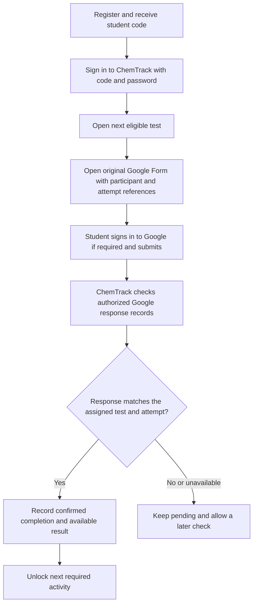

# Student codes and native Google Forms verification

Updated 30 October 2026 (Asia/Manila). Coded invitation registration, code/password login, installation-wide separate counters and teacher password reset are implemented locally and tested. Legacy accounts/history are preserved with neutral display references. The Google Forms flow below remains a specification: only source/link readiness and bypass prevention exist; no authorized response connection is live. See [implementation evidence](../development/site-update-evidence.md).

## Confirmed decisions

- User selected **option 2**: students take the actual Google Form using its original responder interface and any teacher-required Google sign-in. ChemTrack retrieves actual submitted responses/results afterward to confirm completion. The prior custom test-to-Form submission bridge is superseded for research pre-/post-tests.
- Student accounts use assigned codes instead of real names. The user requests assignment at registration, so invitation-based self-registration and teacher-created coded accounts are now supported.
- Format is `ST<number>-G` for girls and `ST<number>-B` for boys.
- The user explicitly chose **separate number sequences**: girls `ST1-G`, `ST2-G`, …; boys `ST1-B`, `ST2-B`, … . Registration order within each group determines its next number.
- Teaching material and actual Forms are not available yet. Prepare with synthetic fixtures and clearly unconfigured connections; do not request missing material repeatedly or claim a live integration passed.

## Proposed registration and sign-in

Suggested flow: teacher issues a single-use study invitation → student opens registration → selects the teacher-approved G/B category and sets/confirms a password → server creates the student account and assigns its code → show the code prominently and offer a way to copy/save it → student signs in using code and password.

This invite flow is implemented to scope enrollment without collecting identity; invitations are hashed, single-use and expire after seven days. Invite use binds the account to its teacher/roster and prevents reusing the same invite to create multiple accounts. It does not identify a physical person; distributing one invite per participant is an operational teacher responsibility. Do not promise detection of all repeat registrations across different invites.

No student real-name, personal-email, Google-profile-name or school-ID field should be required or retained as a workaround for the current schema. Propose keeping Google sign-in solely on the external Google Form; ChemTrack student login uses code/password. Teacher accounts may retain their own name/email and existing login. Student greetings, teacher rosters, enrollment selectors, results and exports must all use the student code. A display-name column, if retained for framework compatibility, contains only the generated code for students. Student email should become optional rather than fabricating an address.

Teacher-assisted password reset is implemented; do not invent email recovery for students without email. The code is an identifier, not a password or authentication token. Existing role isolation, password hashing, rate limiting and server enrollment checks must remain.

## Code generation contract

- Implemented scope: one G counter and one B counter across this ChemTrack installation, covering all programmes/cycles. Do not restart counters per activity/cycle; this makes login codes unique without adding a study selector. Revisit scope explicitly before any future multi-installation/multi-study import scheme.
- Assign only on the server, atomically with account creation and invite consumption. Use a locked counter/transaction and a unique database constraint; counting rows or taking a current maximum without locking is unsafe under concurrent registration.
- Never accept a client-selected code, sequence number, teacher identity or role. Validate G/B selection as agreed with the teacher; do not infer it from names/emails.
- Never reuse an issued code or renumber existing students when accounts are deactivated. Small sequence gaps are acceptable; history integrity matters more than gapless numbering.
- Preserve the assigned code across both cycles, sign-ins and exports. Corrections need an explicit audited policy rather than silent regeneration.
- Preserve existing demonstration attempts and their timestamps during any migration. The sample accounts are fictional, but migrations must still preserve relationships and history. Additive schema changes are applied locally. Legacy accounts are not silently converted; teacher-owned code assignment is available.

Example registration order:

| Registration | Selected group | Assigned code |
| --- | --- | --- |
| First | G | ST1-G |
| Second | B | ST1-B |
| Third | G | ST2-G |
| Fourth | B | ST2-B |

## Native Form completion flow

The teacher/authorized Form owner grants ChemTrack read access. Students do not receive teacher credentials or access to classmates' responses. Google account authentication occurs at Google, not through a custom ChemTrack password form. The former Apps Script write-bridge identity limitation no longer applies to how students submit; this chosen design reads actual native submissions.

Proposed initial sync uses authorized Google Forms response reads when the student explicitly checks completion or the teacher refreshes results, with bounded requests and useful last-checked/error feedback. Add scheduled checks only if hosting supports them and the agreed study needs them. Do not promise instant delivery or add Cloud Pub/Sub/persistent workers by default.

Opening the Form, coming back, pressing “I submitted” or supplying a screenshot does not by itself unlock the next part. Only a matching response from the authorized source confirms that a response was submitted. This confirms submission, not that the student personally answered honestly or understood the material.

## Matching without real names

The Form must include a participant-code question and, under the proposed stronger matching contract, an opaque per-student/per-test attempt reference. ChemTrack prepares a pre-filled responder link. Google Forms supports prefilled answers, but these are ordinary editable fields, not a hidden/locked authentication mechanism.

At verification, the server checks the configured Form/test identity, expected question IDs, participant code, opaque attempt reference and saved ownership/eligibility. It must reject mismatches and quarantine unknown/ambiguous responses. Sequential codes alone are guessable and insufficient for strong account-to-response matching. A unique reference improves linkage but can still be shared; do not claim it proves a person's identity. Never expose all student references or use the same reference across students.

Store a unique `(Form ID, response ID)` receipt so repeated reads are idempotent. Preserve the external submission timestamp, cycle/activity, matched student code and verification time/source. Retrieve an available quiz score only if that result is part of the agreed study; pending/ungraded is not zero. Later response edits or grade changes need reconciliation/audit rather than silent history rewriting. Each cycle/test must map explicitly to its instrument; reusing one one-response-limited Form for multiple required tests may prevent repeat participation and needs review when instruments exist.

## Coded research records and Google settings

This is coded/pseudonymous participation, not a guarantee of full anonymity. The G/B suffix itself discloses the chosen category. Do not claim legal/research approval merely because names are absent.

Propose no name questions and no email collection in the research Form if the teacher's study permits it. Google's official help says the one-response option requires Google sign-in, but usernames are not recorded in responses unless email collection is enabled. This allows native Google sign-in and coded response matching to coexist; Google still handles account authentication. Actual school/domain and Form settings require authorized review later.

Do not import Google respondent emails or names into ChemTrack merely for convenience. Persist only the approved completion/result fields, not an unnecessary duplicate of all research answers. Any roster identity mapping, if required and permitted by the study, belongs under teacher-controlled research procedures outside this repository. Materials, account rules and consent/retention procedures still need teacher confirmation before live use.

## Acceptance checks for implementation

- Separate G/B sequences; simultaneous registrations never issue duplicate codes; failed/retried invite use cannot create multiple accounts.
- Registration and login do not request a student real name/email; every student-facing and teacher/report/export surface shows the code. Teacher identity/access remains intact.
- Code alone cannot log in, enroll a student elsewhere or access another student's work; teacher reset and invitation handling are tested.
- Form link clicks and student assertions do not complete a test; a matching authorized response does. Wrong Form/cycle/code/reference, unknown responses, API permission loss and network failure remain pending/flagged.
- Repeated reads do not duplicate completions or change original completion times. Ungraded scores remain missing. Existing native assessment history survives migration.
- Use deterministic fake responses for local checks; separately verify actual Google authorization/read/matching on an approved synthetic test Form once available. Fake success is never presented as a live integration.

## Status and next decisions

Confirmed: native Form interface, response verification, code-only student identities and separate G/B numbering. Invitation-based self-registration, code/password login and installation-wide sequences are now implemented defaults. Opaque per-test matching, response storage and actual teacher-authorized reads still need configuration/validation. Real materials and Google setup remain necessary for a live verification check; native sample tests do not prove it works.

## References

- [Google Forms response reads](https://developers.google.com/workspace/forms/api/reference/rest/v1/forms.responses/list)
- [Response IDs, answers, timestamps and available scores](https://developers.google.com/workspace/forms/api/reference/rest/v1/forms.responses)
- [Google Forms sign-in, email recording and prefilled links](https://support.google.com/docs/answer/2839588?hl=en)
- [Feature inventory](teacher-requirements-feature-plan.md)
- [Prior custom-interface feasibility discussion](google-forms-custom-interface.md) — retained as history; not the selected research-test approach
